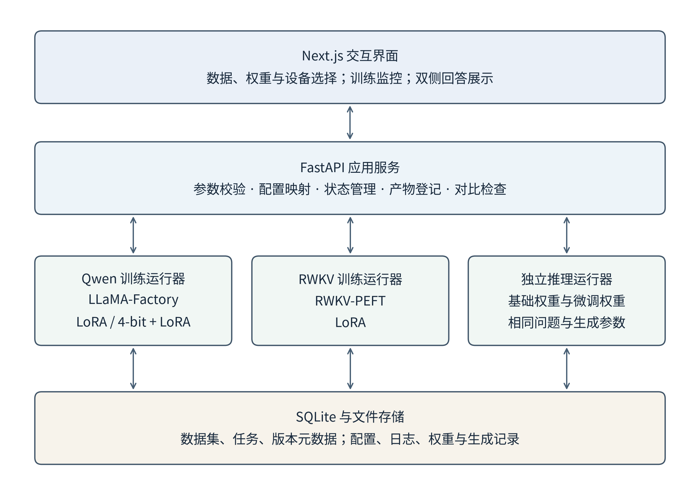
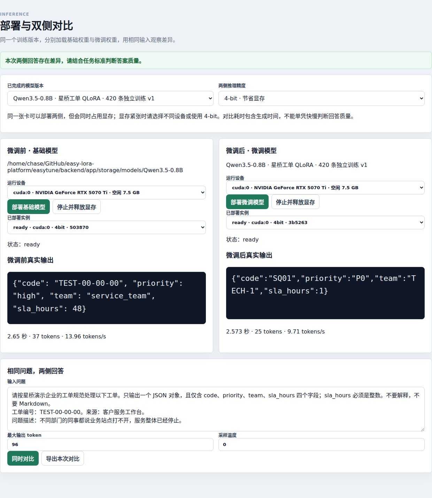
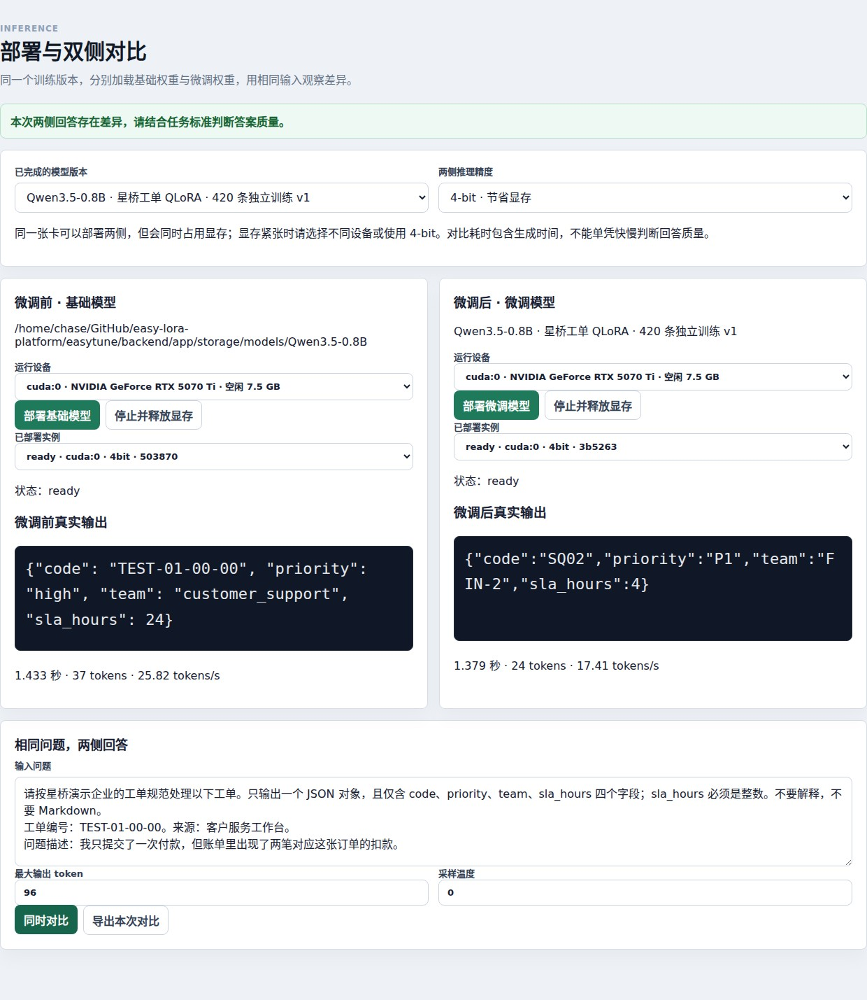

# 面向少卡环境的轻量化语言模型微调与对比验证平台设计与实现

作者：魏常见，周鑫泽 
项目名称：EasyTune 轻量化模型微调平台  
完成日期：2026年11月

## 摘要

针对小型研发团队在语言模型适配过程中面临的数据格式不统一、训练配置分散、计算资源有限以及微调效果难以直观验证等问题，设计并实现了面向单卡环境的轻量化模型微调平台EasyTune。系统采用前后端分离架构，将数据集导入与转换、基础权重选择、设备配置、训练前检查、任务监控、产物登记和双侧推理对比组织为连续的操作流程。训练端分别接入LLaMA-Factory与RWKV-PEFT运行路径，支持以LoRA及4-bit量化结合LoRA的方式完成模型适配；推理端对基础权重和微调权重建立独立实例，并统一同一对比中的问题、生成参数及计算精度。在单张NVIDIA GeForce RTX 5070 Ti显卡上，使用Qwen3.5-0.8B、Qwen3.5-2B和RWKV7-G1L-1.5B，分别开展企业工单路由、商品评价情感分类和中文纠错三组短程实验。结果显示，Qwen3.5-0.8B在7道工单测试上的严格匹配结果由0/7提升至3/7，JSON可解析结果由6/7提升至7/7；Qwen3.5-2B在6道情感测试上微调前后均为6/6；RWKV在6道纠错测试上由6/6变为5/6，其中未通过案例表现为对正确原句的同义改写。实验验证了平台从数据准备到训练、部署及结果检查的工程可行性，同时表明短程微调的任务收益取决于数据、基础模型能力与评价约束。本文的贡献主要在于多运行路径的流程整合、结果可追溯设计和对照验证方法，不涉及新的模型结构或训练算法。由于实验使用合成小样本且缺少多随机种子重复，结论适用于当前原型与任务设置，尚不能外推为生产业务中的稳定收益。

**关键词：** 参数高效微调；LoRA；量化微调；单卡训练；模型对比验证

## 1 绪论

### 1.1 研究背景与问题提出

预训练语言模型为文本分类、信息抽取和业务问答提供了可复用的基础能力，但通用模型掌握的知识与具体组织的操作规则之间仍存在差距。例如，企业工单中的类别编码、责任团队和响应时限通常由内部流程定义，模型即使理解了用户的问题，也未必能够生成符合该流程的结构化答案。因此，模型适配需要同时处理任务知识、输出约束和实际运行条件，不能仅以自然语言回答是否流畅作为成功标准。

全参数微调需要维护较多可训练权重及优化器状态，对显存和训练环境提出较高要求。LoRA通过低秩增量参数进行适配，QLoRA进一步将量化基础权重与低秩训练相结合，为受限资源下的模型适配提供了技术基础。[[1]](https://arxiv.org/abs/2106.09685) [[2]](https://arxiv.org/abs/2305.14314) 然而，采用轻量化训练方法并不意味着用户能够直接完成整个实验。权重目录、数据格式、对话模板、运行环境、训练参数和产物加载方式之间仍存在依赖关系，任一环节不一致都可能使训练失败，或者使展示结果不能真实反映微调效果。

在项目实施过程中，另一个突出问题是训练结果与应用展示脱节。训练日志中的损失下降可以说明模型正在拟合当前训练目标，却无法直接说明业务问题已经得到正确回答；微调完成后，如果只展示模型名称、任务状态或单侧输出，也难以判断变化来自新增权重、量化方式还是生成参数。为此，需要将训练流程管理与基础模型、微调模型的成对验证联系起来，使实验结论能够回溯到相同问题下的真实输出。

### 1.2 研究目标与研究范围

本文以EasyTune平台的设计和实现为研究对象，目标是在单张消费级显卡条件下，建立能够选择已有权重和数据、配置设备与训练参数、监控任务、管理产物并比较两侧回答的完整工作流程。系统重点降低重复配置成本，明确异常发生的位置，并保留判断结果所需的配置和输出证据。

研究围绕三个相互关联的问题展开：异构模型训练工具如何通过统一任务对象组织；有限显存环境下如何完成轻量化训练及成对推理；如何区分流程可运行、回答发生变化与任务表现得到改善。本文通过平台实现、接口回归检查和三组真实训练实验回答这些问题。算法层面采用现有LoRA及量化微调方法，不将工具整合表述为新的参数更新算法，也不将不同任务上的少量测试结果作为模型家族之间的能力排名。

实验范围限定为文本输入和文本输出。实际验证对象为Qwen3.5-0.8B、Qwen3.5-2B与RWKV7-G1L-1.5B。平台中的其他模型配置入口属于可扩展实现范围，本文不将未执行完整实验的模型计入验证结果。研究采用合成数据开展原型验证，尚未进行真实企业流量下的持续运行、多人使用效率或业务收益评估。

### 1.3 论文组织

本文首先介绍参数高效微调及相关工具基础，随后说明系统需求、总体架构和关键模块实现；在此基础上给出数据构造、训练配置和评价规则，并分析三组实验的整体结果、成功案例与失败原因；最后讨论研究局限和后续改进方向。完整测试问答与记录说明作为配套附录提供，以便复核正文中的统计结论。

## 2 相关研究与技术基础

### 2.1 参数高效微调与量化微调

LoRA在冻结基础权重的条件下，通过低秩矩阵表示权重增量。[[1]](https://arxiv.org/abs/2106.09685) 对于原始权重矩阵$W_0\in\mathbb{R}^{d_{out}\times d_{in}}$，其适配形式可写为

$$
W=W_0+\frac{\alpha}{r}BA,\qquad
A\in\mathbb{R}^{r\times d_{in}},\quad
B\in\mathbb{R}^{d_{out}\times r}.
\tag{1}
$$

其中，$r$为低秩维度，$\alpha$为缩放系数。当$r$远小于输入、输出维度时，该矩阵对应的增量参数数量为$r(d_{in}+d_{out})$。从平台实现角度看，低秩适配使基础权重与任务增量可以分别管理，但也要求推理时加载与适配器对应的基础模型，不能将适配器目录视为任意模型均可使用的独立完整权重。

QLoRA将低位量化基础权重与LoRA训练结合，以降低基础模型权重的存储开销，其研究同时讨论了NF4、双重量化和分页优化器等设计。[[2]](https://arxiv.org/abs/2305.14314) 本项目使用4-bit权重量化与LoRA组合开展Qwen实验，并使用BF16训练配置。这里的“量化微调”指实际配置中的权重量化和低秩参数更新，不意味着本文独立复现了原论文的全部优化组件及大规模性能结论。

监督训练的一般目标可以表示为

$$
\mathcal{L}=-\frac{1}{\sum_{i,t}m_{i,t}}
\sum_{i,t}m_{i,t}\log p_{\theta_0,\phi}(x_{i,t}\mid x_{i,<t}),
\tag{2}
$$

其中，$\theta_0$表示基础权重，$\phi$表示可训练参数，$m_{i,t}$表示损失计算掩码。该表达式强调，训练目标不仅取决于模型和数据内容，也取决于哪些位置参与损失计算。本项目的不同运行路径存在数据组织和掩码处理差异，因此训练损失只能在各自配置下解释，不能直接跨模型比较数值高低。

### 2.2 训练框架与模型加载基础

LLaMA-Factory提供了多模型训练方法与配置接口的统一组织方式，并通过界面降低训练操作门槛。[[3]](https://aclanthology.org/2024.acl-demos.38/) 本项目复用其Qwen训练路径，在外围补充数据管理、任务状态、产物登记和成对输出检查。Transformers则提供模型、分词器与生成接口的公共基础，使权重加载和文本生成能够通过相对统一的接口完成。[[4]](https://aclanthology.org/2020.emnlp-demos.6/)

Qwen3.5-0.8B和Qwen3.5-2B的官方模型资料将其列为带视觉编码器的因果语言模型，并提供相应权重与配置。[[5]](https://huggingface.co/Qwen/Qwen3.5-0.8B) [[6]](https://huggingface.co/Qwen/Qwen3.5-2B) 本文仅研究其文本使用路径，训练配置冻结视觉编码器与多模态投影部分，不开展视觉数据微调或多模态能力评价。因此，本文中的“0.8B”和“2B”沿用模型名称与语言模型规模标识，不据此推算整个运行进程的显存需求。

RWKV-7采用动态状态演化机制，其模型结构和状态管理方式与常见的注意力模型运行路径存在差异。[[7]](https://arxiv.org/abs/2503.14456) 本项目为其配置单独的训练和推理加载路径，实际验证的权重为本地RWKV7-G1L-1.5B。论文引用RWKV-7研究用于说明架构背景，而具体G1L权重的训练结果以本项目记录为依据，不以其他RWKV规模或版本的公开成绩代替本轮实测。

### 2.3 本项目的工程研究定位

现有训练框架已经覆盖大量模型和参数高效训练方法，本项目的研究空间主要在于将这些能力连接为可检查的实际操作流程。对于初次使用者，能否辨认模型文件是否完整、数据是否已经转换、设备是否存在冲突、任务是否真正完成以及两侧是否加载了不同权重，直接影响平台可用性。

因此，本文的设计重点是任务对象及其证据链，而非对上游算法进行重新命名。数据集、配置、运行日志、模型版本和生成结果之间建立关联后，用户既可以观察成功案例，也可以检查失败案例发生在哪一阶段。这样的设计为后续增加训练方法或替换底层引擎保留了接口，同时避免将界面中的配置选项数量等同于已经验证的模型能力。

## 3 系统需求与总体设计

### 3.1 业务流程与功能需求

平台的基本操作过程从数据与权重选择开始。用户可以选择已经导入的数据集和本地权重，设置适配方式、运行设备及主要训练参数，经训练前检查后启动任务。任务运行过程中，界面展示状态和日志；成功生成训练产物后，系统建立模型版本，并允许分别加载基础权重和微调权重进行推理。这个过程需要保持数据、模型和设备之间的依赖关系，避免用户在不完整的输入条件下直接启动训练。

数据获取既包括本地文件，也包括数据URL。面对包含多个文件或数据划分的仓库，平台需要先解析可选文件，再由用户选择实际导入对象；遇到不支持的文件类型、权限不足、文件过大或网页内容时，需要给出明确原因。对于需要身份凭据的数据来源，配置入口应与访问错误相对应，同时避免在普通展示内容中回显令牌值。

推理对比的需求不限于并排显示两个文本框。系统应确保两侧来自同一训练版本对应的基础模型与适配产物，并在相同问题、输出长度和温度条件下生成回答。记录中同时保存两侧输出及相关生成参数，使用户能够在关闭推理进程后继续查看结果。展示用截图应来自这些实际输出，而不以人工编写的“优化后答案”替代模型生成内容。

### 3.2 分层架构

系统采用交互层、服务层、运行层和存储层相互配合的架构。交互层基于Next.js构建，负责数据管理、训练配置、任务监控和双侧结果展示。服务层基于FastAPI提供接口，将请求参数转为后端任务对象，并处理输入检查、运行器选择及状态更新。运行层通过独立进程调用训练和推理组件，使长时间模型任务不直接阻塞界面请求。存储层使用关系数据库管理任务元数据，并使用文件系统保存数据、配置、日志、权重和结果文件。

图1 EasyTune系统总体架构

在这一结构中，训练框架负责执行具体学习过程，平台服务负责解释用户意图、组织运行条件和保存结果关联。两者的职责边界能够减少界面代码与模型实现之间的耦合。例如，新增模型家族时，主要变化集中在兼容性检查、配置映射、运行器选择和权重加载部分，而数据集编号、任务状态和版本关联仍可以沿用既有对象。

当前系统面向本地单机原型使用。训练任务按设备检查活动状态，本文实验按模型依次运行；同一对比中的基础模型与微调模型可以同时驻留显存，而生成请求在同一设备上串行执行。这一安排降低了两侧生成时争抢计算资源的影响，但并不等同于全局显存调度器，也不能排除平台之外的进程占用设备。

### 3.3 核心数据对象与关联关系

平台以数据集、训练任务和模型版本作为主要对象。数据集记录原始文件、转换文件、格式和样本数；训练任务记录基础模型、训练方式、额外参数、输出目录及状态；模型版本通过任务编号关联训练来源，并记录适配器或合并权重的位置。对比结果记录问题、两侧回答和模型版本标识，由此形成从输入材料到最终输出的关联链。

表1 核心对象及其主要作用

| 对象 | 主要信息 | 在流程中的作用 |
|---|---|---|
| 数据集 | 文件类型、样本数、转换状态、质量检查结果 | 确定训练输入及其可用性 |
| 训练任务 | 模型家族、基础权重、训练参数、状态、日志 | 描述和跟踪一次训练执行 |
| 模型版本 | 来源任务、基础模型、适配产物、就绪状态 | 将训练结果连接到推理加载 |
| 推理实例 | 模型版本、基础或微调角色、设备、精度、状态 | 区分两侧实际加载的权重 |
| 对比记录 | 相同问题、生成参数、两侧输出、耗时 | 支持结果查看和实验复核 |

这些对象的关联不应被理解为完整的实验治理平台。当前产物清单能够记录文件信息，并对满足大小条件的文件计算校验值；大文件并非全部生成完整校验和。因而，现有实现提供的是基础可追溯能力，进一步的统一版本快照、不可变数据集和完整权重校验仍需要完善。

## 4 关键模块设计与实现

### 4.1 数据导入、转换与可用性检查

数据模块同时提供本地上传、已有文件导入和URL导入入口。URL解析器支持JSON、JSONL、CSV和Parquet等文件形式，并将仓库链接转为候选文件列表。对于Hugging Face仓库，解析过程记录具体修订信息，避免仅依赖可能发生变化的默认分支名称。不同数据划分不会自动拼接，从而减少将测试内容无意混入训练数据的风险。

文件可下载与样本可训练是两个不同判断。下载完成后，系统还需要识别数据字段、检查缺失内容并转换为训练运行器可接受的形式。对于指令数据，平台将任务说明、输入和输出组织为一致的记录；对于已有对话数据，则检查消息顺序和回答完整性。质量检查用于发现结构性问题，不能替代人工审核标签正确性、授权范围或业务代表性。

网络导入采用下载大小限制、重定向检查和目标地址校验。访问受限来源时，界面根据凭据配置情况提供补充入口，后端不将令牌原值作为常规返回字段。上述措施服务于明确的数据获取边界和异常反馈，不能据此推导平台已经完成覆盖所有部署环境的安全审计。

### 4.2 训练配置映射与执行前检查

统一界面中的训练请求需要转换为不同运行器的具体配置。对于Qwen，界面选择的QLoRA在底层配置中表现为LoRA训练加4-bit量化，而不是向训练框架传入一个未经支持的独立训练类型。对话模板、最大序列长度、低秩维度、梯度累积和数据目录均在启动前写入配置文件。对于RWKV，平台则根据其训练入口组织层数、隐藏维度、上下文长度、算子、精度和参数高效训练配置。

执行前检查覆盖数据转换状态、权重文件、模型模板、设备选择和必要模块导入。检测训练环境时使用独立的短生命周期进程，避免将库导入副作用带入接口服务。模块能够成功导入只说明基本依赖可用，不能保证训练一定不会出现数值异常或显存不足，因此检查结果与实际运行日志必须共同使用。

训练请求通过检查后进入启动和运行状态。平台在同一设备已有活动训练任务时拒绝冲突启动，并通过后台进程保留实际执行日志。取消请求、进程失败和正常退出分别对应不同状态，避免把执行中断统一显示为成功。对于原型使用者，这种状态区分比只展示一个进度百分比更有意义，因为它能够指出后续应检查配置、重新运行还是进入模型管理。

### 4.3 训练产物登记与加载一致性

训练完成后的登记过程扫描输出文件，并建立模型版本与任务之间的关联。Qwen实验主要保存适配器文件及相关配置，推理时将适配器加载到对应基础模型上；RWKV实验保存合并后的权重文件，由独立加载器读取。两种形式在存储开销、复制成本和推理入口上存在差异，平台通过模型家族和产物类型进行区分。

项目调试中曾出现训练计算结束但权重保存失败的情况。这类任务不能仅因日志中出现最后一个训练步就计为成功，必须以产物保存和后续加载结果作为进一步依据。另一个问题来自权重加载器对文件后缀的处理差异：某些加载入口会自动补充后缀，重复传入后可能形成不存在的文件名。系统通过统一入口参数处理消除了本次发现的问题。上述经验说明，模型训练完成后的文件处理并非附属步骤，而是连接训练与部署的必要环节。

当前模型版本的“就绪”状态主要依据产物扫描，仍不能代替完整的推理验证。本文将三组最终任务计为实验完成，是因为它们除正常生成产物外，还实际完成了基础侧和微调侧加载及测试题生成。此前失败或取消的尝试未作为新增成功实验计入统计。

### 4.4 双侧推理与结果展示

推理服务为每个实例指定基础或微调角色，并检查两侧是否属于同一训练版本。若两侧指向相同权重、计算精度不一致或相关分词器来源不一致，接口拒绝将其作为合格的前后对比。对于Qwen，基础侧加载基础权重，微调侧在相同基础权重上加载适配器；对于RWKV，基础侧和微调侧分别读取基础权重与训练生成的合并权重。

生成时，两侧接收相同问题、采样温度和最大输出长度。当两侧使用同一设备时，平台按顺序执行生成请求；使用不同设备时，接口具备并行发起请求的路径，但本文没有测量多设备并行表现。这里的“双侧部署”表示存在两个独立权重实例，并不意味着本文的所有对比都是同时进行GPU计算。

界面保留部署配置、实例状态和真实输出，同时显示生成耗时与输出长度。程序中的“回答是否相同”只进行字符串比较，不是正确性判定。任务评分由实验脚本依据预设标准另行计算。因此，“两侧回答不同”不能自动解释为微调有效，“两侧回答相同”也不意味着权重没有正确加载。

### 4.5 工程验证方法

项目使用接口回归检查验证配置生成、数据转换、下载约束、凭据处理、模型对比约束和结果读取等行为。已保存的回归日志记录52项检查通过，前端生产构建亦完成。浏览器脚本进一步检查了两侧回答能否显示、切换模型后能否读取对应输出，以及刷新页面后记录是否仍可访问。

这些检查与GPU训练实验承担不同职责。接口检查主要验证输入边界及程序行为，真实训练和推理则验证模型文件、运行环境与计算路径能否共同工作。本文没有据此宣称已经完成高并发压力测试或完整的长期稳定性测试，测试通过范围限于实际执行的检查和实验。

## 5 实验设计与评价方法

### 5.1 实验环境与模型配置

实验于2026年11月3日在本地单卡环境中完成，使用NVIDIA GeForce RTX 5070 Ti，显存标称容量为16 GB。平台按顺序执行不同模型的训练与推理阶段，以适应有限设备资源。软件环境按运行路径分开配置，避免不同模型依赖之间的版本约束相互干扰。

表2 实验软件与运行环境

| 层次 | 已核对的主要配置 |
|---|---|
| 前端 | Next.js 14.2.35 |
| 接口与元数据管理 | FastAPI 0.115.6、SQLAlchemy 2.0.36、SQLite |
| Qwen训练环境 | Python 3.12、PyTorch 2.15.0、Transformers 5.2.0、PEFT 0.18.1 |
| Qwen量化组件 | bitsandbytes 0.50.2 |
| RWKV训练环境 | Python 3.12、PyTorch 2.12.1、Lightning 2.6.5、PEFT 0.19.1 |
| 图形计算设备 | NVIDIA GeForce RTX 5070 Ti，单卡16 GB |

表2反映本次环境记录，不构成对其他版本组合的兼容性承诺。实验没有持续采集全部训练阶段的显存峰值，也没有统一测量模型加载、优化步骤和文件写入各阶段的资源开销，因此本文不提供未经记录的显存节约比例或完整成本比较。

### 5.2 数据集构造与划分

三组实验采用不同的合成任务，目的是验证平台在多种数据形态和模型路径上的可运行性。工单任务要求模型从自然语言问题生成包含`code`、`priority`、`team`和`sla_hours`的JSON对象；情感任务要求只输出“正面”“负面”或“中性”；纠错任务要求仅改正错别字，对已经正确的句子保持原样。

表3 数据规模与实际使用范围

| 模型 | 任务 | 准备的训练样本 | 实际训练样本 | 本轮测试题数 |
|---|---|---:|---:|---:|
| Qwen3.5-0.8B | 企业工单路由 | 4200 | 420 | 70 |
| Qwen3.5-2B | 商品评价情感分类 | 2400 | 240 | 65 |
| RWKV7-G1L-1.5B | 中文错别字纠正 | 2400 | 800 | 65 |

工单数据覆盖服务中断、重复扣款、账号锁定、配送延误、退货申请、发票抬头和信息不足等类别，训练和测试使用不同的问题描述模板。数据准备阶段还生成了42条验证样本和61题候选测试题，但本轮快速验证实际只执行其中7道工单题，没有将未执行的候选题纳入统计，也没有使用42条验证样本报告验证损失。基础模型事先不知道实验构造的企业编码与分派规则，这一条件是解释后续结果的关键。

情感训练数据包含三类各8条评价，测试集包含三类各2条新句子。纠错数据准备了24条样本，但RWKV运行器根据`epoch_steps=8`截取数据，实际训练使用前8条。该截取由代码和日志共同确认，因此不能将准备的数据量等同于实际学习的数据量。纠错测试包括5条含错别字的句子和1条原本正确的句子，后者用于检查模型是否产生不必要的改写。

按完整提示字符串核对，三组已执行测试均未与各自训练样本出现完全相同的输入记录。这种检查只能排除精确重复，不能证明语义独立或完全消除模板相似性。所有数据均为小规模合成材料，尚不足以覆盖真实业务中的噪声、多轮上下文和复杂边界条件。

### 5.3 训练与推理参数

Qwen实验使用低秩维度为8、缩放系数为16的LoRA适配器，并启用4-bit基础权重量化。两个规模采用相同学习率和随机种子，序列长度及梯度累积根据任务调整。RWKV使用LoRA短程训练，采用FP32训练配置，并通过FLA算子路径执行。训练范围和训练步数见表4。

表4 实际训练参数

| 参数 | Qwen3.5-0.8B | Qwen3.5-2B | RWKV7-G1L-1.5B |
|---|---|---|---|
| 微调方式 | 4-bit量化 + LoRA | 4-bit量化 + LoRA | LoRA |
| 低秩维度／缩放系数 | 8／16 | 8／16 | 8／16 |
| 序列长度上限 | 256 | 128 | 128 |
| 单次设备批大小 | 1 | 1 | 1 |
| 梯度累积步数 | 8 | 2 | 1 |
| 学习率 | $2\times10^{-4}$ | $2\times10^{-4}$ | 初始$2\times10^{-4}$，目标末值$10^{-5}$ |
| 训练轮次 | 1 | 1 | 1个短程训练轮次 |
| 实际优化步数 | 53 | 12 | 8 |
| 训练计算配置 | BF16 | BF16 | FP32 |
| 显式设置的随机种子 | 42 | 42 | 本轮请求未显式统一设置 |

RWKV日志记录可训练参数为7,077,888个，总参数为1,534,746,624个，可训练比例约为0.4612%。该数值对应本次具体实现和训练部分设置，不能推广为所有1.5B模型的LoRA参数比例。Qwen与RWKV的数据损失处理也不完全相同：RWKV本次JSONL路径对序列进行移位预测并处理填充位置，未采用仅针对回答部分的独立损失掩码配置。这一差异限制了跨模型训练损失的解释。

推理阶段的最大新增token数统一为96，采样温度为0。每个模型的基础侧与微调侧使用相同精度：Qwen两侧均为4-bit，RWKV两侧均为FP16。不同模型之间没有统一成同一种精度，因而本文仅进行各模型内部的前后对比，不使用这些记录比较不同模型的绝对推理效率。

### 5.4 评价指标与判定规则

本文将流程完成情况与任务效果分别评价。流程评价关注任务能否完成实际训练、生成产物、登记版本并进行两侧推理；任务评价则根据事先设定的输出要求判定单题是否通过。两种评价不能互相替代，尤其不能将“任务完成”直接换算为“回答正确”。

设第$i$道题的模型输出为$\hat{y}_i$，参考答案为$y_i$，任务判定函数为$g$，则严格匹配率定义为

$$
\mathrm{EM}=\frac{1}{N}\sum_{i=1}^{N}\mathbf{1}\left[g(\hat{y}_i,y_i)=1\right].
\tag{3}
$$

对工单任务，判定函数要求输出能够解析为JSON对象，字段集合与标准一致，各字段的值和类型均正确，其中`sla_hours`必须为整数。对情感和纠错任务，脚本去除答案两端空白后进行完整文本比较，额外解释、标签变化或不必要的改写均不满足当前标准。精确匹配是一种任务契约评价，不应被解释为对所有语义等价表达的质量排序。

为解释工单任务中的局部变化，进一步计算JSON可解析数量以及各字段正确数量。字段正确率可表示为

$$
A_f=\frac{1}{N}\sum_{i=1}^{N}\mathbf{1}\left[\hat{y}_{i,f}=y_{i,f}\ \land\ \operatorname{type}(\hat{y}_{i,f})=\operatorname{type}(y_{i,f})\right],
\tag{4}
$$

其中，无法解析的输出在所有字段上计为错误。字段指标用于定位问题，不能替代整条工单的严格通过要求。由于测试题数少且任务不同，本文优先报告正确题数与分母，并将百分比作为辅助说明，不对三个任务的百分比作简单平均。

## 6 实验结果与分析

### 6.1 流程执行与训练记录

三组最终任务均完成了实际训练、产物生成、模型版本登记以及基础侧和微调侧的推理。Qwen3.5-0.8B完成53个优化步骤，Qwen3.5-2B完成12个步骤，RWKV完成8个步骤。Qwen训练器记录的训练循环耗时分别为343.7404秒和27.0161秒，平均训练损失分别约为0.2697和0.4105。这些时间不等同于从提交任务到截图生成的总时长，不能忽略环境启动、模型加载和产物保存开销。

RWKV日志记录了训练终止、权重保存和模型版本创建信息，但没有与Qwen完全相同定义的训练汇总文件。因此，本文不将其终端中显示的单步损失或计时片段并入Qwen的平均损失与耗时比较。保持统计口径一致，比为了补齐表格而混用不同指标更有利于结果解释。

系统检查方面，52项接口回归检查与前端生产构建通过，浏览器端验证了对比记录读取和两侧输出显示。上述证据与三组GPU实验共同说明原型流程已具备可操作性，但尚不能据此判断多人并发、长期运行或复杂任务调度条件下的稳定程度。

### 6.2 三组任务的整体结果

表5给出了所有已执行测试的严格匹配结果。由于三组任务的标签空间、数据规模和基础模型先验不同，该表仅用于观察每一行内部的前后变化。

表5 各模型在各自任务上的微调前后结果

| 模型与任务 | 微调前 | 微调后 | 前后变化 | 结果解释 |
|---|---:|---:|---:|---|
| Qwen3.5-0.8B／工单路由 | 0/70，0.0% | 30/70，42.9% | 增加30道通过题 | 部分规则和输出字段得到学习 |
| Qwen3.5-2B／情感分类 | 65/65，100.0% | 65/65，100.0% | 通过题数不变 | 简单测试集上未观察到收益 |
| RWKV7-G1L-1.5B／中文纠错 | 65/65，100.0% | 55/65，83.3% | 减少10道通过题 | 对正确句子产生了同义改写 |

Qwen3.5-0.8B的严格匹配率增加约42.9个百分点，但这一变化建立在7道合成工单题上。基础模型不知道虚构企业的内部规则，因此较低基线并不说明其通用理解能力完全缺失，而是反映其不能凭空获得规则。另一方面，微调后仍有4道题未完全通过，说明模型对编码、团队和时限之间的绑定关系学习不充分。

Qwen3.5-2B在本轮测试中存在明显的基线饱和现象。正面、负面与中性的判断属于其已经能够完成的简单任务，6道题在微调前已全部答对，因而该测试集难以展示额外训练的收益。实验结果不能证明微调没有改变权重，也不能证明更多复杂情感题仍然全部正确，只能说明当前已执行题目没有观察到严格匹配提升。

RWKV的结果则说明微调可能改变本来满足任务要求的回答。5条含错别字的句子在两侧均得到正确修正，而正确原句被微调模型进行了同义替换。对要求尽量保持原文的纠错任务而言，这种变化应当被记录为任务偏差，而不是因为语句通顺就自动判为改进。

### 6.3 工单任务的字段级变化

为了分析工单任务的改善来自哪些部分，表6列出了JSON可解析情况及四个输出字段的正确数量。

表6 Qwen3.5-0.8B工单任务的结构与字段结果

| 检查项目 | 微调前 | 微调后 |
|---|---:|---:|
| 输出可解析为JSON对象 | 6/7 | 7/7 |
| 类别编码`code`正确 | 0/7 | 7/7 |
| 优先级`priority`正确 | 0/7 | 6/7 |
| 处理团队`team`正确 | 0/7 | 3/7 |
| 响应时限`sla_hours`正确 | 1/7 | 5/7 |
| 四字段及类型全部正确 | 0/7 | 3/7 |

微调后类别编码全部正确，而处理团队仍只有3道题正确。这说明本轮训练对类别识别和结构化输出形成了较明显影响，但对类别与责任团队之间的精确对应学习不足。与只报告JSON格式合法相比，字段级检查能够更清楚地揭示这种部分学习现象。

例如，账号锁定和配送延误案例的微调输出都能够生成相应类别编码，却将处理团队写为`TECH-1`。退货案例还存在响应时限错误，发票抬头案例同时涉及优先级、团队和时限偏差。如果实际业务系统只检查JSON是否可解析，这些内容错误可能在结构检查通过后继续流入下游处理。因此，平台展示与业务验证应同时关注格式和取值关系。

### 6.4 典型改善案例

服务中断测试描述为“不同部门的同事都说业务站点打不开，服务整体已经停止”。按照实验预设规则，应输出类别`SQ01`、优先级`P0`、处理团队`TECH-1`和1小时响应时限。微调前模型将工单编号本身当作类别编码，并生成通用的优先级和团队名称；微调后四个字段均符合规则。表7保留了该案例的逐字段差异。

表7 服务中断案例的真实输出对比

| 字段 | 微调前输出 | 微调后输出 | 预设标准 |
|---|---|---|---|
| `code` | `TEST-00-00-00` | `SQ01` | `SQ01` |
| `priority` | `high` | `P0` | `P0` |
| `team` | `service_team` | `TECH-1` | `TECH-1` |
| `sla_hours` | 48 | 1 | 1 |

图2 Qwen3.5-0.8B服务中断案例的部署与输出对比

重复扣款案例描述一次付款对应两笔扣款。微调前模型输出通用客服团队和24小时时限，未满足企业规则；微调后输出`SQ02`、`P1`、`FIN-2`和4小时时限，实现了从通用描述到任务规定字段的映射。该变化不仅涉及措辞不同，还涉及分派对象与处理时限不同，因此更能反映本次微调任务的目标。

图3 Qwen3.5-0.8B重复扣款案例的部署与输出对比

信息不足案例的输入为“能来个人帮我一下吗？目前没有更多细节”。预设规则要求模型避免直接确定业务类别，而应输出`SQ00`、`REVIEW`、`HUMAN-0`和时限值0。微调前模型仍给出高优先级及客服处理建议，微调后则按照约定转入人工审核。这里的时限值0是本实验规定的占位值，不代表真实业务中的零时限服务承诺。

图4 Qwen3.5-0.8B信息不足案例的部署与输出对比

图2至图4均来自同一个Qwen3.5-0.8B训练版本，展示的是7道工单题中通过标准发生改善的3道题，并非三个不同模型均产生改善的证据。为了确认截图与实际生成相符，制作图片时使用相同权重及生成参数重新运行了这3道题，得到的原始回答与对应记录一致。这种重复生成只核验了展示内容，不构成重新训练、增加独立测试样本或多随机种子实验。

### 6.5 持平与退化案例的解释

情感任务中，“外观漂亮而且运行流畅，这次购物太满意了”在Qwen3.5-2B微调前后均得到“正面”；“订单编号是AB12，包含两根连接线”在两侧均得到“中性”。这类相同输出是本轮实验的真实结果。对于已经被基础模型较好解决的简单任务，继续训练能否改善困难样本、边界判断或固定格式稳定性，需要更具区分度的测试集才能回答。

纠错任务中，原句“会议安排没有变化。”无需修改。RWKV基础模型保留了该句，而微调模型输出“会议安排没有改变。”。两者语义接近，但后者违反了当前任务对正确原句保持不变的要求，因此严格匹配由通过变为未通过。这一例子说明评价标准必须与应用目标一致：如果研究目标是语义保持，可能需要更宽松的指标；如果研究目标是最小修改纠错，则不必要的改写本身就是需要改进的行为。

对当前RWKV结果，不宜仅将偏差归因于模型架构。训练实际只覆盖8条样本，且任务目标、损失掩码和训练长度与Qwen实验不同。小样本、样本顺序及目标设置均可能影响输出，现有实验尚未隔离这些因素。本文因此将该现象作为进一步研究的线索，而不提出超出记录支持范围的因果结论。

## 7 局限性与后续研究

### 7.1 实验设计的局限

本文使用合成数据和少量测试题，能够验证流程并观察特定输出变化，但不足以估计真实业务中的平均收益。工单类别较规则化，情感题目较简单，纠错数据覆盖的错误类型也有限；训练和测试虽然没有完全相同的提示字符串，却仍具有相似领域和模板特征。因此，后续需要补充来自实际任务分布、经过授权和标注审核的数据，并扩大独立测试集。

工单实验还缺少一个重要对照，即将完整企业规则直接提供给基础模型的提示词方案。当前基础模型未获知虚构规则，而微调模型通过训练样本接触了规则；这足以验证任务适配现象，却不能证明微调优于提示词工程或规则查表。后续应在相同信息条件下比较基础模型加规则提示、微调模型和确定性规则程序，从而区分信息提供方式、模型学习和系统成本之间的关系。

三组实验均未开展多随机种子重复和系统超参数搜索，RWKV请求也未与Qwen统一显式随机种子。数据规模、精度和训练目标同时存在差异，无法将结果差别单独归因于模型规模、架构或微调方法。本文不进行统计显著性推断，所给出的成功比例均为有限样本上的描述性结果。

### 7.2 平台能力的局限

当前平台已经具备基础任务管理与结果关联能力，但训练进度、文件完整性检查和资源调度仍有改进空间。不同运行器的日志形式不一致，使精确进度和统一性能统计存在难度；仅根据产物存在及大小判定就绪，也不能替代模型结构校验和实际加载检查。后续可将加载验证作为版本发布前的独立阶段，并对较大权重文件补充可持续执行的完整校验机制。

设备检查主要针对平台管理的任务，不能完全掌握其他程序的显存占用变化。更完善的实现需要在任务启动前测量可用资源，并在运行中持续记录显存、耗时和异常信息。本文的双侧推理仍面向实验对比，没有评估多用户并发服务能力，因此不应将原型界面的部署功能直接等同于生产级推理服务。

### 7.3 后续研究方向

后续工作应将统一评价模块与平台任务对象进一步结合。当前正确性评分由实验脚本完成，界面主要展示原始回答和字符串差异；如果能够在数据集层面定义参考答案、字段规则和评价方式，平台便可以自动区分格式正确、字段部分正确和整题通过，并持续保留每次评测的完整结果。

训练研究方面，可在固定数据划分和评价规则后比较不同低秩维度、学习率、训练步数与回答掩码策略，重点观察工单团队字段绑定错误和纠错任务过度改写的问题。对于基线已经达到满分的简单情感测试，应优先扩大任务难度与类别边界，而不是仅增加训练轮次。只有在实验设计能够区分方案差异的前提下，更多计算投入才有助于形成可信结论。

面向使用体验，可围绕任务完成时间、配置错误发生率和失败恢复成本开展用户研究，并据此评价平台是否真正降低了操作门槛。本文目前通过统一入口和自动检查改善了流程组织，但尚未测量上述用户指标，后续应将这些指标纳入工程效果评价。

## 8 结论

本文面向单卡资源条件下的语言模型适配需求，完成了EasyTune轻量化微调与对比验证平台的设计和实现。系统将数据导入与转换、模型和设备选择、训练前检查、实际任务执行、产物登记及双侧推理连接为连续流程，通过任务对象关联输入、配置、权重和生成记录，为模型适配实验提供了基础可追溯能力。

在单张RTX 5070 Ti上开展的三组实验验证了Qwen与RWKV两类运行路径。Qwen3.5-0.8B工单任务的严格匹配结果由0/7提升至3/7，字段分析显示类别编码和输出结构得到改善，但团队映射等问题仍然存在；Qwen3.5-2B情感任务微调前后均为6/6，未在当前简单测试中观察到提升；RWKV纠错任务由6/6变为5/6，偏差来自对正确原句的同义改写。结果共同表明，平台流程完成、回答发生变化和任务性能改善属于不同层面的评价，必须分别验证。

本研究的主要价值在于将已有训练算法与异构运行器组织为可操作、可观察和可复核的工程原型，并通过完整报告成功、持平和失败结果说明其适用范围。现有证据支持平台在本轮小模型、合成数据和单卡条件下完成训练与对比流程；关于更广泛业务收益、性能优势及长期稳定性的结论，仍需更大规模数据、公平基线和重复实验进一步验证。

## 参考文献

[1] HU E J, SHEN Y, WALLIS P, et al. [LoRA: Low-Rank Adaptation of Large Language Models](https://arxiv.org/abs/2106.09685)[EB/OL]. arXiv:2106.09685, 2021[2026-11-03]. DOI: 10.48550/arXiv.2106.09685.

[2] DETTMERS T, PAGNONI A, HOLTZMAN A, et al. [QLoRA: Efficient Finetuning of Quantized LLMs](https://arxiv.org/abs/2305.14314)[EB/OL]. arXiv:2305.14314, 2023[2026-11-03]. DOI: 10.48550/arXiv.2305.14314.

[3] ZHENG Y, ZHANG R, ZHANG J, et al. [LlamaFactory: Unified Efficient Fine-Tuning of 100+ Language Models](https://aclanthology.org/2024.acl-demos.38/)[C]//Proceedings of the 62nd Annual Meeting of the Association for Computational Linguistics (Volume 3: System Demonstrations). Bangkok: Association for Computational Linguistics, 2024: 400-410. DOI: 10.18653/v1/2024.acl-demos.38.

[4] WOLF T, DEBUT L, SANH V, et al. [Transformers: State-of-the-Art Natural Language Processing](https://aclanthology.org/2020.emnlp-demos.6/)[C]//Proceedings of the 2020 Conference on Empirical Methods in Natural Language Processing: System Demonstrations. Association for Computational Linguistics, 2020: 38-45. DOI: 10.18653/v1/2020.emnlp-demos.6.

[5] QWEN TEAM. [Qwen3.5-0.8B: Model Card](https://huggingface.co/Qwen/Qwen3.5-0.8B)[EB/OL]. Hugging Face[2026-11-03].

[6] QWEN TEAM. [Qwen3.5-2B: Model Card](https://huggingface.co/Qwen/Qwen3.5-2B)[EB/OL]. Hugging Face[2026-11-03].

[7] PENG B, ZHANG R, GOLDSTEIN D, et al. [RWKV-7 “Goose” with Expressive Dynamic State Evolution](https://arxiv.org/abs/2503.14456)[EB/OL]. arXiv:2503.14456, 2025[2026-11-03]. DOI: 10.48550/arXiv.2503.14456.

